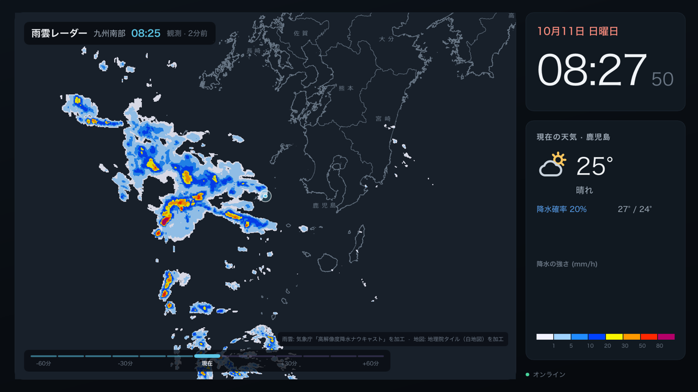
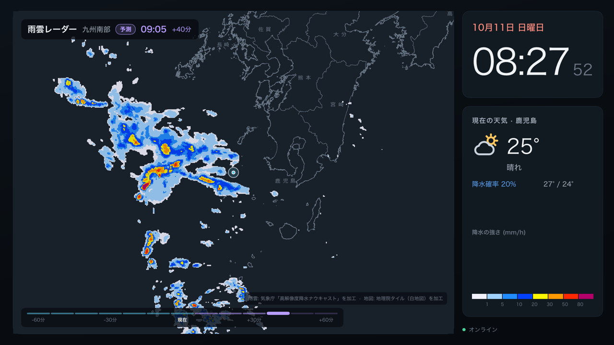
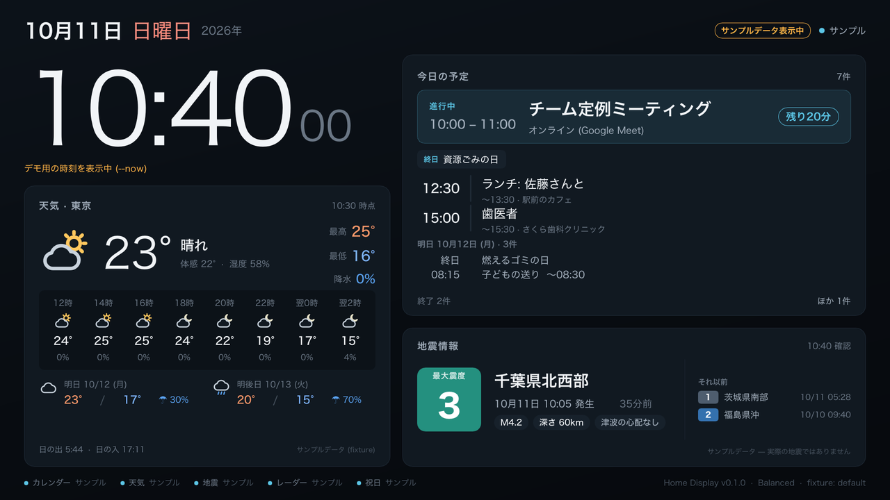
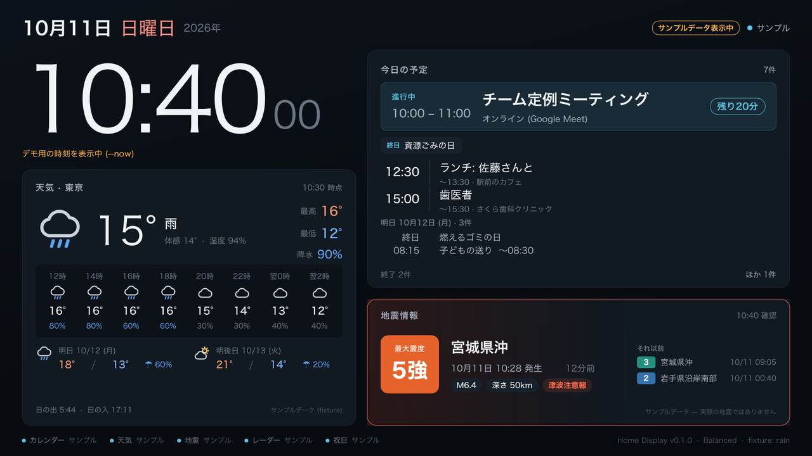
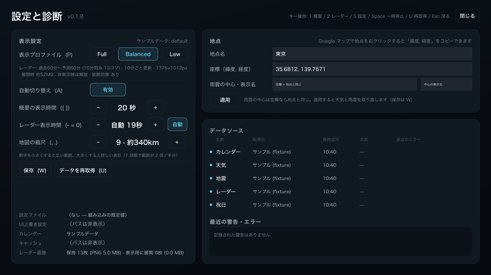

# Home Display

> [!IMPORTANT]
> **このプロジェクトは、AI（Claude Code）によるバイブコーディングで作成しています。**\
> 作者が作りたいものの思想とアーキテクチャを伝え、コードは AI が書いています。\
> Raspberry Pi などの Linux 実機での動作はまだ確認していません（[検証状況](#検証状況)）。\
> ライセンスは MIT です。

## 本プロジェクトについて

<!-- ここから作者の自由入力欄 -->

2017 年に紙のカレンダー「Magic Calendar」の記事を見て、欲しくて欲しくて、数年の月日が経ちました。\
https://gigazine.net/news/20170222-magic-calendar/

いまでは、個人で作ってみたプロジェクトや記事もあります。

- https://github.com/lee-pham/mcal
- https://github.com/kristiantm/eink-family-calendar-esp32
- https://github.com/speedyg0nz/MagInkDash
- https://zenn.dev/ryoskate/articles/fda8bb7e481541
- https://note.com/twofaults/n/nb60d45a6d5ce

個人的には、もう少し大きい画面にカレンダーや天気などを表示できるといいな、と思っていました。\
Raspberry Pi などで常時稼働できるのが理想ですが、E-Ink ディスプレイはまだ高価です。

一方で、モバイルディスプレイは比較的買いやすい値段になってきました。\
そこで、15.6 インチのモバイルディスプレイを対象に、Raspberry Pi で動くものを作ろうと思いました。

アーキテクチャには、最近流行りの Electron のような、Web 技術ベースで高いマシンスペックを必要とするものではなく、
組み込みでも使える Rust と Slint を選びました。

重要な点として、このプロジェクトはバイブコーディングで作っています。\
作りたいものの思想とアーキテクチャを伝え、AI がコードを書いています。

コードは MIT ライセンスなので、煮るなり焼くなり、ご自由にどうぞ。

<!-- 作者の自由入力欄ここまで -->

## 概要

リビングやデスクに常時表示する情報ディスプレイです。Rust + [Slint](https://slint.dev) のネイティブアプリで、
Linux では X11 / Wayland を使わず **DRM/KMS に直接描画**（Slint LinuxKMS）することを目標にしています。
Electron / WebView / HTML / JavaScript は使っていません。

| 雨雲レーダー（実データ・観測） | 雨雲レーダー（実データ・1 時間予測） |
|---|---|
|  |  |
| **Overview（サンプルデータ）** | **重要な地震があるとき（サンプルデータ）** |
|  |  |
| **設定・診断（サンプルデータ）** | |
|  | |

> - 雨雲レーダーの 2 枚は **実データ** です（2026-10-11 08:25 JST の観測と 40 分後の予測、九州南部、縮尺 8）。
>   出典: 気象庁「高解像度降水ナウキャスト」を加工、地図: 地理院タイル（白地図）を加工。
> - Overview / 設定画面は **fixture（サンプルデータ）** をソフトウェアレンダラーで描画したもので、
>   画面上にも「サンプルデータ表示中」「デモ用の時刻を表示中」と表示されます。
> - 設定画面の「UI上書き設定」「キャッシュ」の欄は、開発機のフォルダの場所が写るため塗りつぶしています。

## 主な機能

- **Overview** — 大きな時計（秒表示つき）、日付・曜日・祝日、今日と明日の予定（進行中/次の予定を強調、終日予定、
  件数上限と「ほか N件」、予定なし・取得失敗・未設定を区別。日付が変わった直後に取り直し）、現在の天気と時間別・翌日以降の予報、
  最新の地震情報（震度・震源・M・深さ・津波。強い揺れは警告色）、データソースごとの状態
- **Radar** — 気象庁の雨雲を画面の主役に。**過去 1 時間の実測 → 現在 → 1 時間先までの予測** をアニメーション。
  予測は紫のタイムラインと「予測」バッジで実測と区別。現在地マーカー、気象庁の雨量凡例（mm/h）、出典表示。
  読み込み中（進捗 %）・取得失敗・データなし・古いデータ・代替データ表示を区別
- **設定・診断** — 表示プロファイル、自動切り替え、表示時間、地図の縮尺、**地点（緯度・経度）** を画面上で変更・保存。
  データソースの状態・最終成功・次回取得・直近エラー、設定ファイルの場所、最近の警告ログ、Radar のメモリ使用量
- **自動ローテーション** — Overview 20 秒 ↔ Radar **自動**（アニメーション 2 周分 ≒ 18.5 秒、静止画は 10 秒）。
  雨雲の初回取得が終わるまでは Radar に切り替えず、進捗（%・コマ数）を 1 秒ごとに表示
- **表示プロファイル** — Full / Balanced / Low（端末の性能に合わせて雨雲のコマ数・装飾を調整）
- **鮮度管理** — 取得時刻とデータ時刻を区別し、期限切れのデータは「HH:MM 時点の古いデータ」と明示（天気は減光）
- **障害に強い** — 取得失敗時は直前の正常データを保持し、指数バックオフで再試行。気象庁から取れない場合は
  P2P地震情報 / RainViewer に自動で切り替え
- **fixture モード** — 認証情報なしで全画面と主要な状態（予定多数・予定なし・終日・長い名前・祝日・晴れ/曇り/雨・
  地震あり/なし/強い地震・レーダーあり/なし・ネットワークエラー・古いデータ）を再現

## 推奨ハードウェア

| プロファイル | 最低ライン | 快適 |
|---|---|---|
| Low | Raspberry Pi Zero 2 W（512 MB） | Pi 3A+ / 3B+ |
| Balanced（既定） | Pi 3B+（1 GB） | **Pi 4（2 GB 以上）** |
| Full | Pi 4（2 GB） | **Pi 4（4 GB）/ Pi 5** |

- 目安は macOS での実測（最大メモリ: Low 約 90 MB / Balanced 約 175 MB / Full 約 230 MB）からの見積もりで、
  **Raspberry Pi 実機では未計測**です。
- OS は Raspberry Pi OS Lite 64-bit / Debian 12・13（arm64・amd64、glibc 2.36 以上）。端末側に Rust は不要です。
- Zero と同じ 65×30 mm で Full を狙うなら Radxa Zero 3W（4 GB）、Orange Pi Zero 2W / Banana Pi BPI-M4 Zero（4 GB）が候補です
  （いずれも未検証。Mesa の Panfrost ドライバーと Debian 12 以降のイメージが前提）。
- **設置**: モバイルディスプレイの背面に面ファスナー等で固定できます。Pi 4 の映像出力は micro HDMI
  （USB-C は電源専用で映像は出ません）。電源は 5 V 3 A、ディスプレイとは別系統（2 ポートの USB-C 充電器など）を推奨。
- **冷却**: ファンは不要。ディスプレイ背面は熱がこもるため、アルミの放熱ケース（ファンレス）と数 mm のすき間を推奨。
  `vcgencmd measure_temp` / `vcgencmd get_throttled` で確認できます。

## クイックスタート（macOS / Windows / Linux デスクトップ）

[mise](https://mise.jdx.dev/) で Rust 1.98.1（rustfmt / clippy 付き）とタスクを管理しています（[`mise.toml`](mise.toml)）。
CI は同じ版を [`rust-toolchain.toml`](rust-toolchain.toml) から使います。

```sh
mise trust && mise install        # 初回のみ
mise run dev                      # サンプルデータで起動（設定・認証情報不要）
mise run dev -- --fixture rain    # シナリオ指定（一覧: mise run fixtures）
mise run live                     # 実データで起動
mise run demo                     # 時刻を 10:40 に固定して全画面表示
mise run check                    # fmt --check → clippy → test（CI と同じ）
mise run screenshots              # 全シナリオを target/shots/ に PNG 出力
mise run                          # タスク一覧から選択
```

- プロジェクト内では `cargo` も直接使えます（mise が 1.98.1 を有効にします）。
- 開発用の秘密情報は `.env.example` を `.env`（git 管理外）にコピーして記入すると、mise が自動で読み込みます。
- デスクトップでは **1920×1080 の固定サイズウィンドウ**（サイズ変更不可）で表示します。
  `--scale 1.5` で拡大、`--fullscreen` で全画面です。

```sh
cargo run -- --now 2026-10-11T10:40 --fixture default   # 時刻を固定してデモ（時計は進みます）
cargo run -- --profile low                               # プロファイルを一時的に指定
cargo run -- --check-config                              # 設定の検証（実際に使われる値を表示）
```

### キー操作 / タッチ

| キー | 動作 |
|---|---|
| `1` / `2` | Overview / Radar |
| `S`（`F2`） | 設定・診断画面の開閉 |
| `←` `→`、画面タップ | 画面を切り替え |
| `Space` | 自動切り替えの一時停止 / 再開 |
| `U`（`F5`） | 全データを再取得（同じデータは 15 秒以上空けて実行） |
| `Esc` | Overview に戻る |

設定画面では次のキー（またはボタン）が使えます。

| キー | 動作 |
|---|---|
| `P` | プロファイル切替（Full / Balanced / Low） |
| `A` | 自動切り替えの ON / OFF |
| `[` `]` | Overview の表示時間 −/+ 5 秒 |
| `-` `=` / `0` | Radar の表示時間 −/+ 5 秒 / 自動に戻す |
| `,` `.` | 地図の縮尺 −/+（5〜11。変更すると雨雲を取り直し） |
| 「地点」カードの「適用」 | 地点名・座標・雨雲の中心を反映（天気と雨雲を取り直し） |
| `W` | 保存（再起動後も維持） |

右上隅の長押し（1.2 秒）でも設定画面を開けます。設定画面は 120 秒操作がないと Overview に戻ります。
入力機器がない端末では自動ローテーションのみで運用できます。

### ヘッドレスのスクリーンショット

```sh
cargo run --release -- --fixture default --now 2026-10-11T10:40 --screenshot-dir shots/
# → shots/default-balanced-{overview,radar,settings}.png（1920×1080、ソフトウェアレンダラー）

# 実データの雨雲を予測コマで撮る例（アニメーションを 6 秒進めてから描画）
cargo run --release -- --config packaging/config/config.toml --screen radar \
  --screenshot radar.png --screenshot-advance 6s
```

`--screenshot-wait <時間>` でデータ待ちの上限（既定 90 秒）を変えられます。短くすると取得中の画面も撮れます。

## 設定

設定の優先順位は **コマンドライン > 設定画面で保存した値 > config.toml > 既定値** です。
環境変数で読むのは **カレンダーの秘密 URL（`HOME_DISPLAY_ICAL_URL`）だけ** です。

### 設定画面で保存（おすすめ）

`S` で設定画面を開き、プロファイル・自動切り替え・表示時間・地図の縮尺・地点を変えて `W` で保存します。
保存先は `<state dir>/ui-overrides.toml`（Linux の systemd 下では `/var/lib/home-display/`）で、
再起動や `.deb` の更新でも消えません（`apt purge` 時のみ削除）。管理者が管理する config.toml は書き換えません。

### 設定ファイル

探索順: `--config <path>` → `~/.config/home-display/config.toml` → `/etc/home-display/config.toml`。
どれもなければ組み込みの既定値（**fixture モード**）で起動します。
全項目と既定値はコメント付きの [`packaging/config/config.toml`](packaging/config/config.toml) を参照してください。

```sh
cp packaging/config/config.toml ~/.config/home-display/config.toml   # mode = "live"
home-display --check-config     # 検証（iCal URL は「configured (hidden)」とだけ表示）
```

### 秘密情報（iCal URL）

Google カレンダーの「iCal 形式の非公開アドレス」は**ソースコード・設定ファイル・Git に含めないでください**。
次の順で読み込みます（最初に見つかったもの）。

1. 環境変数 `HOME_DISPLAY_ICAL_URL`（開発時は `.env`、本番は `/etc/home-display/home-display.env`）
2. systemd credential `ical-url`（`LoadCredential=ical-url:/etc/home-display/ical-url`）
3. `calendar.ical_url_file`（URL だけを書いたファイル、0600 推奨）
4. `calendar.ical_url`（非推奨）

URL はログ・エラーメッセージ・診断画面に出力されません。

### 地点

設定画面の「地点」カードに、地点名と「緯度, 経度」を入力して「適用」します（検索機能はありません）。
Google マップで地点を右クリックすると、先頭に「35.6812, 139.7671」の形式で座標が表示され、クリックでコピーできます。

- 天気はこの地点で取得し、雨雲レーダーもこの地点を中心に表示します。
- 「雨雲の中心」に別の座標を入れると、雨雲だけ別の場所を中心にできます（空欄なら地点と同じ）。
- 適用するとその場で天気と雨雲を取り直します。古い地点のデータは表示しません。
- 全角数字・全角カンマも受け付けます。日本の範囲外の座標では雨雲・地図が表示されない旨を表示します。
- config.toml の `[location]`（`name` / `latitude` / `longitude` / `timezone`）でも設定できます。タイムゾーンは config.toml のみです。

#### マウスなし・SSH から設定する（Linux / Raspberry Pi）

設定画面の入力欄はクリックかタップで選ぶため、**キーボードだけでは入力できません**（Tab で移動できません）。
また LinuxKMS には日本語入力（IME）がないので、画面上では「札幌」のような日本語の地点名を打てません。
マウスやタッチパネルを使わない場合は、SSH でファイルを編集して再起動します（日本語も書けます）。

**方法 1: config.toml（設定画面で地点を保存したことがない場合）**

```sh
sudo nano /etc/home-display/config.toml
#   [location]
#   name = "札幌"
#   latitude = 43.0621
#   longitude = 141.3544
sudo systemctl restart home-display
```

**方法 2: ui-overrides.toml（設定画面で一度でも保存した場合はこちら）**

設定画面で保存した値は config.toml より優先されます。`/var/lib/home-display/ui-overrides.toml` に
`location` があると、config.toml の `[location]` を書き換えても反映されません。
その場合はこのファイルを直接編集します（無ければ新規作成。書いた項目だけが上書きされます）。

```sh
sudo nano /var/lib/home-display/ui-overrides.toml
#   location_name = "札幌"
#   location = "43.0621, 141.3544"      # 「緯度, 経度」の文字列
#   radar_center = ""                    # 任意。空なら地点と同じ。別の場所なら "43.0, 141.0"
#   radar_center_name = ""               # 任意。雨雲の中心の表示名
#   radar_zoom = 8                       # 任意。地図の縮尺 5〜11
sudo systemctl restart home-display
```

- 使えるキー: `profile`（`"full"` / `"balanced"` / `"low"`）、`rotation_enabled`、`overview_seconds`、
  `radar_seconds`（`0` = 自動）、`radar_zoom`、`location_name`、`location`、`radar_center`、`radar_center_name`。
- **知らないキーや書式の誤りがあると、ファイル全体が無視されます**（ログに `ignoring invalid ...` と警告が出ます）。
  再起動後に `journalctl -u home-display -n 50` で確認してください。
- 座標の書式が正しくない `location` は無視され、config.toml の値が使われます。
- 地点を config.toml で管理したい場合は、ui-overrides.toml から `location_name` / `location` の行を消します。
- 実行中のアプリはこのファイルの変更を検知しないので、**編集後は再起動が必要**です。
  また、画面で `W` を押して保存するとファイルは画面上の値で丸ごと書き直されます。

### 環境変数

| 変数 | 用途 |
|---|---|
| `HOME_DISPLAY_ICAL_URL` | カレンダーの秘密 iCal URL（このアプリが読む唯一の環境変数） |
| `RUST_LOG` | ログレベル（例 `info,home_display=debug`） |
| `SLINT_BACKEND` | Linux: `linuxkms-femtovg`（GPU、既定）/ `linuxkms-software`（CPU） |
| `SLINT_DRM_OUTPUT` / `SLINT_DRM_MODE` | Linux: 出力コネクター / モード（`list` で一覧） |
| `SLINT_KMS_ROTATION` | Linux: 画面回転 0 / 90 / 180 / 270 |
| `SLINT_SCALE_FACTOR` | UI 倍率（論理 1920×1080 を物理解像度に合わせる。720p なら 0.6667） |

`RUST_LOG` と `SLINT_*` はアプリの設定ではなく、ログ出力と Slint ランタイム（画面出力）が読む変数です。
更新間隔などの細かい調整は config.toml（[`packaging/config/config.toml`](packaging/config/config.toml)）で行います。

## 表示プロファイル

レイアウト・時計・予定・地震・データの取得元はどのプロファイルでも同じです。主に雨雲レーダーと装飾が変わります。

| | Full | Balanced（既定） | Low |
|---|---|---|---|
| 雨雲の範囲 | 過去 60 分 + 予測 60 分 | 過去 60 分 + 予測 60 分 | 最新の観測のみ（静止画） |
| 刻み / コマ数 | 5 分 / 25 コマ | 10 分 / 13 コマ | — / 1 コマ |
| アニメーション 1 周 | 約 9 秒（300 ms/コマ） | 約 9 秒（500 ms/コマ） | なし |
| 雨雲の更新間隔 | 5 分 | 10 分 | 15 分 |
| 合成解像度 | 1376×1012（全プロファイル共通） | 同左 | 同左 |
| 展開時メモリ（目安） | 約 104 MB | 約 54 MB | 約 4 MB |
| 雨雲画面を離れたとき | 展開した画像を保持（すぐ再表示） | 解放 | 解放 |
| グラデーション・影 | あり | あり | なし |
| 時間別予報 | 8 マス（16 時間先まで） | 8 マス | 6 マス（12 時間先まで） |

各項目は `[profiles.<name>]` で個別に上書きできます（例: Low でも予測を 3 コマ表示）。

```toml
[profiles.low]
radar_forecast_frames = 3   # 現在 → +10 分 → +20 分 → +30 分
radar_frame_ms = 800
```

FPS やメモリの数値は**実機で計測していない目安**です。1280×720 などの出力は `display.scale_factor = 0.6667`（または `SLINT_SCALE_FACTOR`）で対応します。

## データソースと利用条件

| データ | 提供元 | 条件・注意 |
|---|---|---|
| 雨雲レーダー | **気象庁 [高解像度降水ナウキャスト](https://www.jma.go.jp/jma/kishou/know/kurashi/highres_nowcast.html)**（気象庁サイト「雨雲の動き」のタイル） | 実測 5 分ごと + **1 時間先までの予測**。陸上・沿岸 250 m（予測 35〜60 分は 1 km）。タイルはズーム 4/6/8/10 のみデータあり → z10 を縮小して表示。**公開 API ではないため予告なく変わる可能性**があり、失敗時は RainViewer に自動切替。気象庁ホームページ利用規約に従い出典と加工の旨を表示 |
| 雨雲（代替） | [RainViewer Weather Maps API](https://www.rainviewer.com/api/weather-maps-api.html) | 過去のみ（10 分刻み、最大ズーム 7 で粗い）。**個人・教育目的のみ無料**、帰属表示必須 |
| 地図 | [地理院タイル](https://maps.gsi.go.jp/development/ichiran.html)（白地図） | リアルタイム利用は出典表示のみで可。30 日ディスクキャッシュ |
| 地震 | **[気象庁 防災情報XML](https://xml.kishou.go.jp/xmlpull.html)**（公式、登録不要） | 震度速報 / 震源に関する情報 / 震源・震度に関する情報 / 遠地地震。高頻度フィードを 60 秒ごと、長期フィードを起動時と 1 時間ごとに取得し、電文は 1 回だけダウンロード（約 30 MB/日。気象庁の遮断基準は 10 GB/日）。EventID で続報を統合し、取消を反映。時刻は気象庁発表の「〜時〜分ころ」。不明値は「不明」のまま |
| 地震（代替） | [P2P地震情報 JSON API v2](https://www.p2pquake.net/develop/json_api_v2/) | 気象庁XMLを取得できないときに自動で使用。60 回/分/IP 上限 |
| 天気 | [Open-Meteo](https://open-meteo.com/) Forecast API | API キー不要、非商用無料（1 万回/日 未満）、**CC BY 4.0（カードに帰属表示）** |
| 祝日 | [内閣府「国民の祝日」CSV](https://www8.cao.go.jp/chosei/shukujitsu/gaiyou.html) | Shift_JIS。7 日ごとに確認しディスクにキャッシュ。初回オフライン時は同梱スナップショット（2026-02 時点、2027 年分まで） |
| 予定 | Google カレンダー等の iCal (ICS) | RRULE / EXDATE / RECURRENCE-ID / 終日 / TZID / キャンセルに対応 |

各取得には接続 10 秒・全体 30 秒のタイムアウト、応答サイズ上限、失敗時の指数バックオフ（30 秒〜最大 30 分）があります。

## Linux / Raspberry Pi へのデプロイ

**Raspberry Pi は [docs/raspberry-pi.md](docs/raspberry-pi.md) の手順で、インストールスクリプト
（[`packaging/raspberry-pi/install.sh`](packaging/raspberry-pi/install.sh)）を使うのが簡単です。**
Release から `.deb` を取得し、iCal URL・地点の入力、自動起動の設定まで行います。以下は手動で入れる場合です。

GitHub Actions がビルドした `.deb`（amd64 / arm64）を使います。どのプロファイルでも同じパッケージです。

```sh
sudo apt install ./home-display_*_arm64.deb
sudo nano /etc/home-display/home-display.env     # HOME_DISPLAY_ICAL_URL を記入（0600）
sudo nano /etc/home-display/config.toml          # 地点・プロファイルなど（任意。設定画面でも可）
sudo systemctl start home-display
journalctl -u home-display -f
```

`.deb` の内容:

- `/usr/bin/home-display`
- `/etc/home-display/config.toml`（conffile、`mode = "live"`。更新時も編集内容を保持）
- `/etc/home-display/home-display.env`（初回のみ作成、0600 root）
- `home-display.service`（インストール時は有効化のみ。設定後に start）
- システムユーザー `home-display`（`video` `render` `input` グループ）

systemd ユニットは専用ユーザー・`Restart=always`・メモリ上限・`ProtectSystem=strict`・デバイス許可リスト
（`char-drm`、`char-input` のみ）などの hardening を設定しています。**root では実行しません。**
ネイティブでビルドする場合の必要パッケージと実機の検証手順は [docs/linux-kms.md](docs/linux-kms.md) を参照してください。

```sh
cargo build --release --no-default-features --features kms   # Linux 上で
cargo deb --no-build --no-strip                               # → target/debian/home-display_*.deb
```

## CI / リリース

[.github/workflows/ci.yml](.github/workflows/ci.yml)

- Rust のバージョンは [`rust-toolchain.toml`](rust-toolchain.toml)（CI）と `mise.toml`（手元）で同じ版に固定。上げるときは両方を変更
- 外部の Actions はコミットの識別子（SHA）で固定
- macOS: fmt / clippy / test / fixture スクリーンショットを artifact 化
- Linux amd64（`ubuntu-24.04`）/ arm64（`ubuntu-24.04-arm`）をそれぞれ **Debian bookworm コンテナでネイティブビルド**
  （glibc 2.36 基準 → bookworm / trixie / Raspberry Pi OS 64-bit で動作する想定）: clippy / test / release ビルド / `.deb`
- `v*` タグを push すると GitHub Release に `.deb` と Raspberry Pi 用の `install.sh` を添付

## アーキテクチャ

```
services/*   (Tokio, 2 workers)  取得 → 解析 → 正規化     ← fixtures.rs（同じパーサーを通す）
   │  Repository::store / fail          radar::Progress（進捗。UI が 1 秒ごとに読む）
repository.rs  最新の正常データ + SourceStatus（鮮度・エラー分類）
   │  snapshot → slint::invoke_from_event_loop
app.rs Controller (UI スレッド)
   ├─ screen.rs   ScreenManager … ローテーションの唯一の管理者（秒境界に合わせた UI タイマー 1 本）
   ├─ view.rs     純粋関数: Snapshot + 時刻 → 表示モデル（PartialEq で差分のみ反映）
   └─ ui_bridge.rs 表示モデル → Slint 構造体
ui/*.slint     表示のみ（Overview / Radar / Settings、テーマ、アイコン）
```

- UI スレッドでは通信・ICS 展開・画像の合成やデコードを行いません（`spawn_blocking`）。
- 雨雲のフレームは PNG のまま保持し、Radar 画面に入るときだけデコード。画面を離れると（Full 以外）解放します。
  観測フレームはキャッシュし、更新時は新しいコマと予測だけを取得します。
- 毎秒は時計だけを再計算し、他のパネルは分が変わったとき・データが更新されたときのみ反映します。
- ログは stderr（systemd 下では journald）と、警告・エラー直近 12 件のリングバッファのみ。ログファイルは作りません。

## テスト

```sh
mise run check    # = cargo fmt --check → cargo clippy --all-targets -D warnings → cargo test
```

単体 87 + UI スモーク 2（Slint testing backend）+ E2E 描画 1。E2E テストは fixture → サービス → コントローラー →
ソフトウェアレンダラー → PNG までを通しで実行します。

## 検証状況

| 項目 | 状況 |
|---|---|
| macOS: ビルド・起動（winit + femtovg ウィンドウ）・自動ローテーション・秒表示 | ✅ 確認済み |
| macOS: fmt / clippy（`-D warnings`）/ 90 テスト | ✅ 成功 |
| 全 fixture シナリオの 1920×1080 描画（ソフトウェアレンダラー） | ✅ 目視確認済み |
| ライブ取得: 気象庁ナウキャスト（実測・予測）+ 地理院タイル / 気象庁XML（地震）/ Open-Meteo / 内閣府 CSV | ✅ macOS から実データで確認 |
| 代替経路: 気象庁 URL を故意に 404 にして RainViewer / P2P地震情報へ自動切替 | ✅ 実データで確認 |
| 雨雲取得中は Radar に切り替えない・進捗の毎秒更新・表示時間の自動計算 | ✅ 実ウィンドウで確認 |
| デスクトップのウィンドウサイズ固定 | ⚠️ 実装済み（Slint の仕様をソースで確認）。手動での操作確認は未実施 |
| ライブ取得: iCal | ⚠️ 実 URL では未確認（パーサーは単体テストと fixture で確認） |
| `--features kms` のコンパイル（macOS ホスト） | ✅ |
| Linux amd64 / arm64 ビルド・`.deb` 生成（CI） | ⏳ ワークフロー作成済み・未実行 |
| LinuxKMS・DRM/KMS・GPU・libinput・systemd の実機動作 | ⏳ **未検証**（[手順](docs/linux-kms.md)） |
| Raspberry Pi での性能・長時間稼働 | ⏳ **未検証** |
| Raspberry Pi 用インストールスクリプト（`install.sh`） | ⏳ **未検証**（構文チェックのみ。実機・Release からのダウンロードは未実行） |
| 日付が変わった直後の予定の取り直し | ⚠️ 待ち時間の計算は単体テストで確認。実際に 0 時をまたぐ動作は未確認 |

## ライセンス

MIT（[LICENSE](LICENSE)）。天気アイコンはこのプロジェクト用に Slint の Path で描いたオリジナルです。
外部データの利用条件は上表の各提供元に従ってください。
